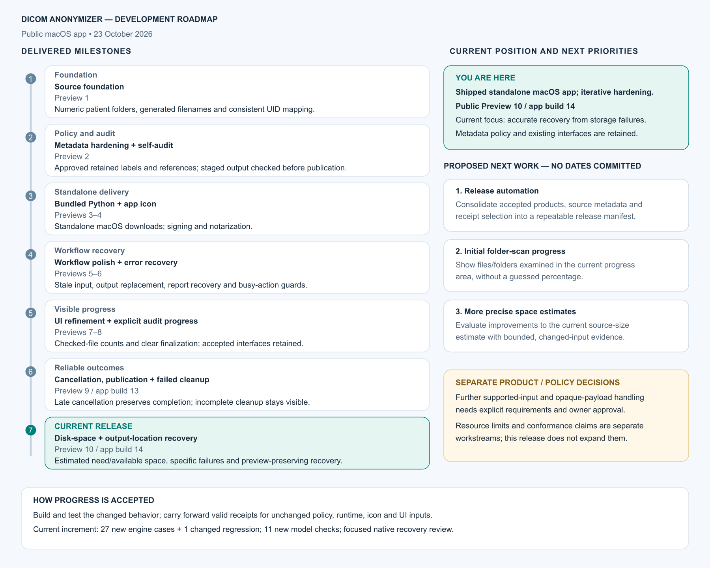

# DICOM Anonymizer — visual development roadmap

Updated 12 November 2026. **Project status: maintenance mode; feature development is paused indefinitely.** Open decisions and deferred work are in the [roadmap](ROADMAP.md). The current milestone is Preview 37/app build 41 (engine policy 2.0-build6): the native app is unchanged from Preview 36/build 40 and was reused, and the engine gained dictionary-VR clearing of identity-bearing elements, the read-only `--explain` and `--verify-output` modes, an engine-interface reference with contract tests, a synthetic benchmark, a canary retention survey and manual-only test and lint scripts. Earlier milestones: descriptor-pinned input reads, the MRI-slice app icon, unified public UI, folder and interruption recovery, optional MRI JSON sidecars, worker feedback, bounded recovery-record reads/messages, RTSTRUCT label enforcement, staged-file header auditing, structured audit coverage, strict DICOM-only staging inventories, recovery-record write protection and guarded publication.

The graphic below is a historical snapshot of the storage-recovery milestone, taken before the release-automation delivery. It has not been updated since; current delivery is stated above and in the [roadmap](ROADMAP.md).

[Open the vector graphic](roadmap/current-roadmap.svg) · [Open the full-resolution image](roadmap/current-roadmap.png)

## Current development stage

The app has a delivered standalone macOS workflow, bundled Python, an app icon, signing/notarization, pre-publication output auditing, visible audit progress and focused recovery. Current delivery includes allocation-aware disk-space estimates, scan/audit and sidecar feedback, and worker-event reliability, with the existing metadata policy retained. One live GUI acceptance pass on synthetic data was done for Preview 36 (see below); live sidecar interaction, recovery, cancellation, responsiveness and compact-window appearance were not observed.

The storage-recovery implementation reuses accepted optimized products and evidence: 27 new engine checks plus one intentionally changed publication regression for the public app, 11 model checks, and native warning/output-replacement review. Earlier unchanged policy, runtime, icon and UI receipts remain in use. See [Storage recovery](STORAGE-RECOVERY.md) for the acceptance and delivery record.

Release assembly and provenance automation is now delivered. See [the delivery record](RELEASE-AUTOMATION-DELIVERY.md); accepted app behavior and verification are retained.

Initial scan activity is now delivered: files/folders examined appear without a total. See [Scan progress](SCAN-PROGRESS.md).

Allocation-aware disk-space estimates are now delivered. See [Disk-space estimate](SPACE-ESTIMATE.md).

## Latest delivered increment

Preview 37/build 41 is an engine-and-documentation release on top of the unchanged
Preview 36 app. Identity-bearing elements (person-name, date, date-time, time and
application-entity values) are now cleared by dictionary VR as well as by the VR a
file declares, at top level and nested, and the self-audit flags survivors; this
tightens de-identification and adds no new rejections. `--explain` and
`--verify-output` are engine-level read-only modes that the app does not expose.
See [Engine interface](ENGINE-INTERFACE.md) and [Maintenance](MAINTENANCE.md).

## Preview 36 live GUI acceptance (synthetic data)

Preview 36/build 40 (descriptor-pinned input reads, new MRI-slice icon) received one
live GUI acceptance pass on synthetic data. Observed: launch, rejection of a wrong
root folder, scan, a batch of two patients and six files, an evicted iCloud Drive
file accepted, and a rename-replaced input; an independent pydicom audit of the
output passed. Not observed: Dock and Finder icon presentation, the input-changed
message, pipe swap, MRI JSON sidecars, cancellation, recovery, large batches, other
macOS versions and real data. See [Runtime acceptance](RUNTIME-ACCEPTANCE.md).

## Preview 36 delivery

Preview 36/build 40: every patient-file read in scanning and processing goes
through one open descriptor, so a path replaced after the regular-file check is
rejected, and the app ships the new MRI-slice icon. Metadata-only changes are still
accepted. Strict DICOM-only staging inventories, conservative recovery-record
updates, audit-coverage reporting, bounded recovery messages, file-header and
RTSTRUCT label audits, and existing publication, terminal-event and Copy Details
behavior are retained. Accepted source/functional evidence was reused. See
[Descriptor-pinned input reads](DESCRIPTOR-READS.md).

## Audit-coverage delivery

Structured audit coverage is delivered in Preview 34/build 38. Reports
separate DICOM and optional JSON-sidecar audit status/counts and explicitly name
retained-content limitations. Five new synthetic report-boundary cases passed;
unchanged verification is reused. This changes reporting only, with no interface
or engine-policy change. Accepted verification was reused for guarded delivery;
no functional test or native build was repeated. See
[Audit coverage](AUDIT-COVERAGE.md).

## Staging and journal protection delivery

Strict DICOM-only staging inventories and recovery-record write protection are
delivered in Preview 35/build 39. Twenty-seven new synthetic methods passed as focused
evidence, with unchanged policy/native/runtime verification reused. The public
interface and metadata policy remain unchanged. No GUI use, app launch, installation
or repeated functional test/native build occurred during guarded delivery.
See [Staging and journal protection](STAGING-JOURNAL-PROTECTION.md).

## Earlier resilience milestone

Interruption recovery records operation ownership/publication state and uses the existing recovery area without automatic resume/deletion. Resumable publication binds a finalized archive to a draft release and reconciles uncertain remote outcomes. Focused synthetic/mock evidence was reused for Preview 19; its first live authenticated publication completed using the new tooling. No GUI use or app launches occurred.

## Recovery lifecycle delivery

Recovery records are aggregated in the existing area, cleaned local records are retired with identity checks, and live owners trigger guarded background reinspection. A headless harness covers the real worker process/pipe boundary. This increment is delivered in Preview 20/build 24; accepted engine/policy and unchanged runtime evidence were reused. See [Recovery lifecycle](RECOVERY-LIFECYCLE.md).

## Recovery explanation delivery

Recovery explanations distinguish confirmed folder identity, uncertain publication and the next inspection step. New headless cases cover the actual worker launch through the batch model’s final state, including cancellation, malformed output and nonzero exits. Source acceptance is separate from live interaction; this increment is delivered as Preview 21/build 25. See [Recovery explanations](RECOVERY-EXPLANATIONS.md).

## Output-location recheck delivery

Valid unresolved recovery locations are rechecked through the existing guarded background chain, including restoration/replacement, with explicit protection for a newer successful output choice. Headless subprocess-to-model cases cover record acknowledgement/retention and preservation of batch data. This increment is delivered as Preview 22/build 26. See [Output-location rechecks](OUTPUT-LOCATION-RECHECKS.md).

## Publication visibility delivery

Publication tooling now reconciles delayed release/asset/published-tag visibility through bounded reads and preserves the existing journal, archive selection and ownership safeguards. Seventeen new mocked methods passed as composite evidence; the changed tooling is used for the Preview 23 release, with the accepted native executable reused. Mock timing guarantees remain separate from live service behavior. See [Resumable publication](RESUMABLE-PUBLICATION.md).

## Recovery-state feedback delivery

Recovery inspection failures are distinct from empty listings and retain prior uncertainty, including after live-owner-only observations. Successful completion with unresolved local-record acknowledgement now retains the result and shows a nonblocking warning through existing controls. This increment is delivered as Preview 24/build 28. See [Recovery-state feedback](RECOVERY-STATE-FEEDBACK.md).

## Recovery consistency delivery

Outstanding acknowledgement warnings are independent of report-error presentation, and single-use generation tokens protect recovery results and scheduled refreshes from intervening actions. Fourteen new headless cases passed; this increment is delivered as Preview 25/build 29. See [Recovery consistency](RECOVERY-CONSISTENCY.md).

## Artifact retirement tooling delivery

Conservative artifact retirement plans first, protects current release inputs and evidence, and requires a separate apply command. Fresh finalizations record metadata ownership for future retirement; legacy unbound bundles/uploads remain retained. Twenty-six new fixture methods passed as composite evidence. This tooling is delivered with Preview 26/build 30; fresh ownership registration was exercised, and no real retirement plan was applied. See [Artifact retirement](ARTIFACT-RETIREMENT.md).

## Decision-dependent future scope

Terminal-event consistency and improved diagnostics in the existing Copy Details
action are delivered in Preview 29/build 33, preserving the public UI and engine
policy. See [Terminal diagnostics](TERMINAL-DIAGNOSTICS.md).

Bounded worker-event buffering and monitored release-storage admission are
delivered in Preview 28/build 32, reusing focused headless evidence and the
accepted compile-only native build. See
[Worker and storage bounds](BOUNDED-WORKER-STORAGE.md). The dated graphic above
remains unchanged; it was not rerendered or reverified.

1. **Resolve supported-input policy decisions separately.** Opaque payloads, unsupported structures, resource limits and conformance claims need explicit scope and approval before implementation. They are listed in the [roadmap](ROADMAP.md); development is paused.

These priorities are proposals, not scheduled commitments. The graphic separates delivered work from future work and decision-dependent scope. Its editable source is SVG, with Arial 10 pt text throughout; the PNG is a rendered copy.
