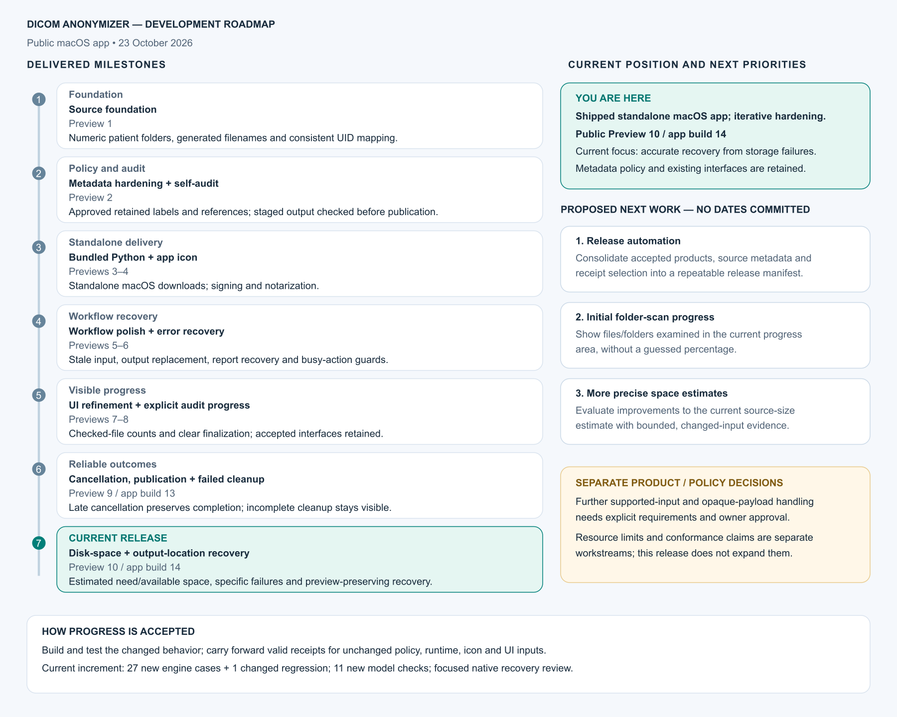

# DICOM Anonymizer — visual development roadmap

Updated 24 October 2026. This view tracks the sole ongoing public app. The current delivered milestone is Preview 18/app build 22: unified public UI, detailed folder recovery, optional MRI JSON sidecars, r2 hardening and worker/sidecar feedback.

The graphic below is the retained storage-recovery milestone snapshot, before the release-automation delivery. Current delivery is stated above; the unchanged graphic was not rerendered or reverified.

[Open the vector graphic](roadmap/current-roadmap.svg) · [Open the full-resolution image](roadmap/current-roadmap.png)

## Current development stage

The app has a delivered standalone macOS workflow, bundled Python, an app icon, signing/notarization, pre-publication output auditing, visible audit progress and focused recovery. Current delivery includes allocation-aware disk-space estimates, scan/audit and sidecar feedback, and worker-event reliability, with the existing metadata policy retained. Live sidecar interaction, startup/recovery, responsiveness and compact-window appearance checks remain pending under the no-GUI restriction.

The storage-recovery implementation reuses accepted optimized products and evidence: 27 new engine checks plus one intentionally changed publication regression per repository, 11 model checks per app, and native warning/output-replacement review. Earlier unchanged policy, runtime, icon and UI receipts remain in use. See [Storage recovery](STORAGE-RECOVERY.md) for the acceptance and delivery record.

Release assembly and provenance automation is now delivered. See [the delivery record](RELEASE-AUTOMATION-DELIVERY.md); accepted app behavior and verification are retained.

Initial scan activity is now delivered: files/folders examined appear without a total. See [Scan progress](SCAN-PROGRESS.md).

Allocation-aware disk-space estimates are now delivered. See [Disk-space estimate](SPACE-ESTIMATE.md).

## Current local implementation

Interruption recovery records operation ownership/publication state and uses the existing recovery area without automatic resume/deletion. Resumable publication binds a finalized archive to a draft release and reconciles uncertain remote outcomes. Both have focused synthetic/mock evidence; neither is deployed in Preview 18. No GUI use or app launches occurred.

## Decision-dependent future scope

1. **Resolve supported-input policy decisions separately.** Opaque payloads, unsupported structures, resource limits and conformance claims need explicit scope and approval before implementation.

These priorities are proposals, not scheduled commitments. The graphic separates delivered work from future work and decision-dependent scope. Its editable source is SVG, with Arial 10 pt text throughout; the PNG is a rendered copy.
